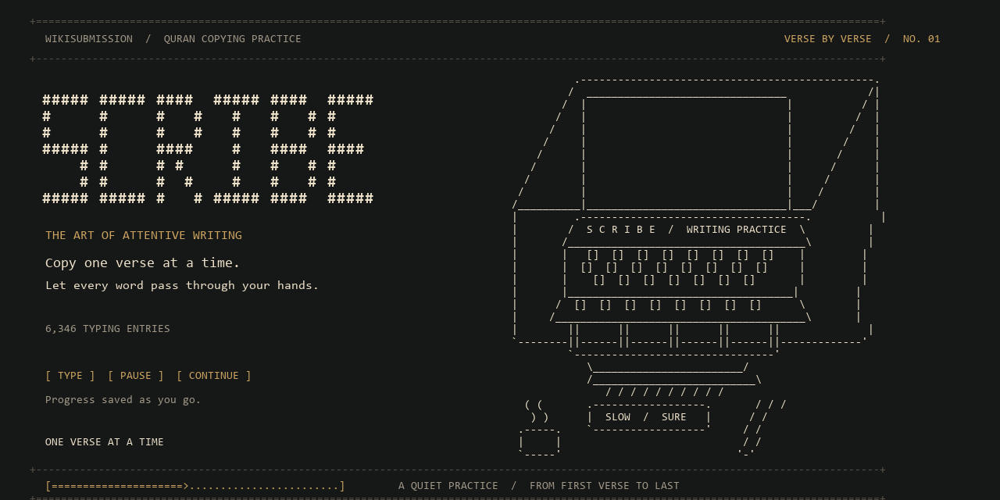

# Scribe — Quran copying practice

A quiet, verse-by-verse writing practice game. Copy one verse at a time and let every word pass through your hands.

## About

Scribe guides you through the Quran in sequence, one verse at a time. The complete copy is presented as 6,346 typing entries, including each surah's opening basmala except surah 9. Your writing progress is saved automatically in your browser.

## Features

- A focused writing desk with one verse displayed at a time.
- Exact-text typing practice; use Backspace to correct mistakes.
- Automatic progress saving in browser storage.
- A progress view with the number of entries remaining and completion by surah.
- A restart option and the ability to begin another full copy.
- A self-contained HTML game with styles, behavior, text, fonts, and artwork embedded.

## Play

1. Download `Scribe.html` from this repository.
2. Open it in a modern browser.
3. Select **Begin writing**, then click the paper and type the displayed verse.
4. Continue through the Quran. Progress saves as you go.

The game needs no server, build step, or package installation. Saves are tied to the browser profile and address used to open the file, so a downloaded copy and hosted copy keep separate progress.

## Repository contents

- `Scribe.html` — standalone playable game.
- `Assets/readme/scribe-ascii-cover.gif` — animated README banner.
- `Assets/readme/scribe-ascii-cover.png` — still version of the banner.
- `Assets/Fonts/*OFL.txt` — license notices for fonts embedded in the game.
- `scripts/build_readme_banner.py` — source script for regenerating the banner.

To rebuild the banner, install Pillow and run:

```bash
python -m pip install Pillow
python scripts/build_readme_banner.py
```

## Text and credits

The English Quran translation is by Dr. Rashad Khalifa and was first published by Islamic Productions. The game reproduces the verse wording for free, credited sharing. See [WikiSubmission's rights and credits page](https://wikisubmission.org/legal/rights) for its sharing guidance. The Arabic Quran text is not subject to copyright.

The fonts embedded in the game are distributed under the SIL Open Font License; their notices are included under `Assets/Fonts/`.
